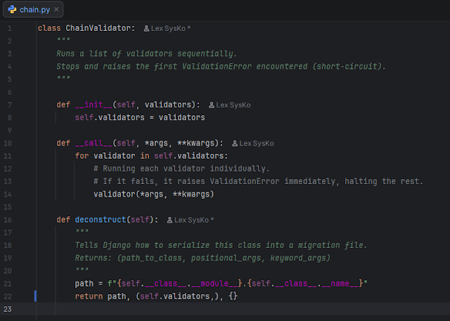

 📍Ever had a model field fail three different validation checks at once,
flooding your user or API response with multiple error messages?

💧 By default, Django runs every validator in a validators list and returns
all triggered ValidationError exceptions together. But in many cases, you want
to short-circuit the validation - stop at the very first error so the user
only sees one fixable issue at a time.  
  
Here is a lightweight
ChainValidator class that does exactly that!

[](https://blogger.googleusercontent.com/img/b/R29vZ2xl/AVvXsEj2tet6kt-NO7mkbjMWqH59ko2-xzicYG4XIV9vNti7C-10aHSitQGhk_TzT7m6HxFQZQhLBmtSk_h0_NqPREkPNx808zrewgA2CiAmph3e_UF8CZWv8qtsowlr4QxAzLTgC81US23fnk4lOrCkxvMaw6E79wiDH55Uj-xlLEqLcahNJ7I65MPqQipUd9I/s774/%D0%97%D0%BD%D1%96%D0%BC%D0%BE%D0%BA%20%D0%B5%D0%BA%D1%80%D0%B0%D0%BD%D0%B0%202026-11-10%20004314.png)  
*classChainValidator*

It runs your validators sequentially, stops immediately at the first failure,
and includes a deconstruct() method so Django can seamlessly serialize it into
database migration files.
  

* [chain.py](https://gist.github.com/lexsysko/908d2462394f66ae6b99fbb1bab5651f)

✅ Usage:  

```
name = models.CharField(max_length=100,validators=[ChainValidator([validate_first_name, ua_name_validator])])
```
