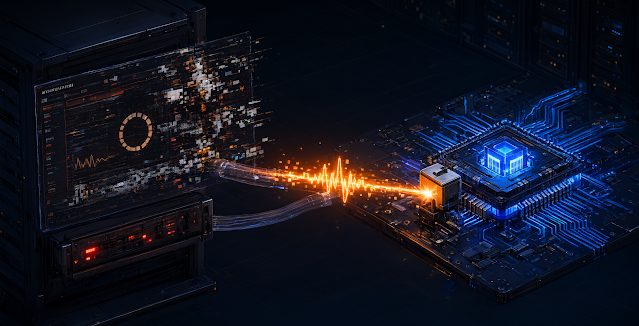

**Why I did this:** my master DNS VM froze, but Proxmox still saw it as
“running”, so HA never failed it over. A watchdog fixes exactly that: if the
guest stops feeding a hardware timer, QEMU resets the VM, even though the
Proxmox host thinks it is fine.

[](https://blogger.googleusercontent.com/img/b/R29vZ2xl/AVvXsEjc4aJkBfS03Asb3eRwZgiZVpm8_xFOAjU7AnkUkhtvHgdhkawPFTYUQIJGf3ScPl5KipHEPsrL8YQVJdf-dBD469zlElUBq16ZaQcoYtLBg31_qGxuKbLcIV0b8-pXkWJFZQGqAtNEwECTIN34851JkY89yC5T-fmFJmvBEkG3bOrd9ClQ0JiX4Bt-sb4/s2752/proxmox-watchdog.png)

## How it works in one minute

1. QEMU gives the VM a virtual Intel 6300ESB watchdog chip
   (`i6300esb`).
2. Inside the guest, a daemon (`watchdogd` on FreeBSD) keeps
   resetting the timer every few seconds.
3. If the guest hangs, the timer reaches zero and QEMU runs the configured
   action (`reset`), like pressing the reset button.

The reset is done by QEMU on the host, not by the guest, so it still works
when the guest OS is completely frozen.

## Part 1: Proxmox

Add the watchdog device. Replace `200` with your VM ID:

```
qm set 200 --watchdog model=i6300esb,action=reset
```

Then do a **full stop and start** of the VM from Proxmox. A reboot from
inside the guest does not apply new hardware.

Check that it took effect:

```
qm config 200 | grep watchdog
qm showcmd 200 | tr ' ' '\n' | grep -i -A1 -e watchdog -e i6300
```

You should see `action=reset` in the first command. In the second
one you should see the `i6300esb` device and
`-watchdog-action` followed by `reset`.

## Part 2: FreeBSD guest

Enable the feeder daemon:

```
sysrc watchdogd_enable="YES"
service watchdogd start
```

If the device doesn’t show up as shown below, also try loading the module at
boot:

```
echo 'ichwd_load="YES"' >> /boot/loader.conf
```

Reboot, then check that the guest sees the chip and that a driver attached to
it:

```
pciconf -lv | grep -B4 6300
```

A good result looks like this. Note that the entry starts with a driver name
and unit (`i6300esbwd0`), not `none0`:

```
i6300esbwd0@pci0:0:4:0: class=0x088000 ... vendor=0x8086 device=0x25ab ...
    vendor     = 'Intel Corporation'
    device     = '6300ESB Watchdog Timer'
```

You can also check the module:

```
kldstat | grep ichwd
```

## Part 3: Test it for real

The checks above only prove that the guest sees the device. They don’t prove
the VM will actually be reset.

Arm the timer and don’t feed it. Check `man watchdog` for what
`-t` means on your version, then choose a value of roughly 40–70
seconds:

```
watchdog -t <value>
```

Wait at least two minutes. If the VM resets, it works.

## Gotchas

* Changing the watchdog setting needs a full stop and start, not a guest
  reboot.
* The software messages (pre-timeout, soft-timeout, KDB backtrace) come from
  the guest kernel and are not the hardware reset. Don’t treat them as proof.
* The watchdog protects against a hung guest OS. It won’t help if the QEMU
  process on the host is stuck, or if the OS is alive but the service (named)
  is dead.

## Bonus: catch a dead service too

`watchdogd` can run a check command with `-e`. If your
check fails or hangs, the daemon stops feeding the timer and the VM resets.
See `man watchdogd` for the exact behaviour and the time limits.
